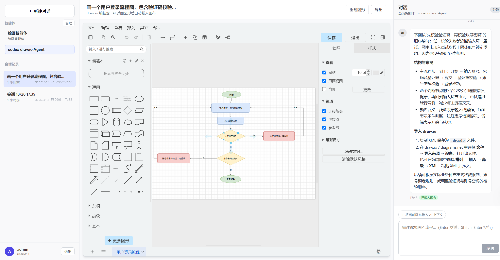
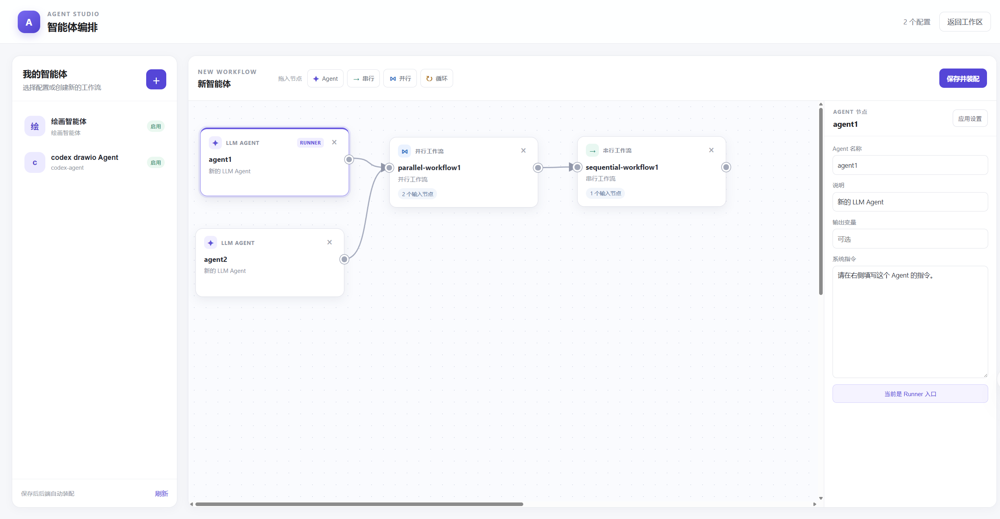

# AI Agent Draw.io Assistant

AI Agent 后端与流程图助手前端组成的单仓库。

## 前端页面

### 绘图与对话工作区

工作区整合智能体和会话列表、Draw.io 流程图画布与 AI 对话面板。用户可以描述需求，由智能体生成流程图并加载到画布中。



### 智能体编排

通过画布组合 Agent、串行、并行和循环工作流，并在右侧配置所选节点的名称、指令和输出信息。



## 目录

- `ai-agent-scaffold-lite-backend/`：Java 17、Spring Boot 3.4 和 Maven 多模块后端。
- `ai-agent-scaffold-lite-frontend/`：React、TypeScript、Vite 前端。

## 启动

后端配置文件含数据库口令和配置加密密钥，不纳入 Git。首次运行前，从模板复制本地配置，并设置自己的数据库环境变量和 `AGENT_CONFIG_ENCRYPTION_KEY`：

```powershell
$resourceDir = "ai-agent-scaffold-lite-backend/ai-agent-scaffold-lite-app/src/main/resources"
Copy-Item "$resourceDir/application.yml.example" "$resourceDir/application.yml"
Copy-Item "$resourceDir/application-dev.yml.example" "$resourceDir/application-dev.yml"
```

模板文件使用 `.yml.example` 后缀；本机实际的 `application*.yml` 会被 Git 忽略。请勿把真实密钥写进模板。

部署用的 Compose 模板也使用 `.yml.example` 后缀。运行前复制所需模板为同名 `.yml` 文件，再通过环境变量提供口令；本机生成的 `.yml` 不会进入 Git。

先启动后端（需要 Java 17、Maven 和项目所需的数据库/模型配置）：

```bash
cd ai-agent-scaffold-lite-backend
mvn -pl ai-agent-scaffold-lite-app -am spring-boot:run
```

后端默认监听 `http://localhost:8091`。另一个终端启动前端：

```bash
cd ai-agent-scaffold-lite-frontend
pnpm install
pnpm dev
```

Vite 开发服务器会把 `/api/v1/**` 请求代理到 `http://localhost:8091`。后端地址可通过 `VITE_API_PROXY_TARGET` 调整。更多接口与使用说明见前后端目录中的 README。

调用外部模型或 MCP 的手动集成示例需要从环境变量读取凭据：`AI_API_KEY`、`BAIDU_MCP_API_KEY` 和 `API_KEY`。不要把真实密钥写入源码、配置文件或提交记录。
